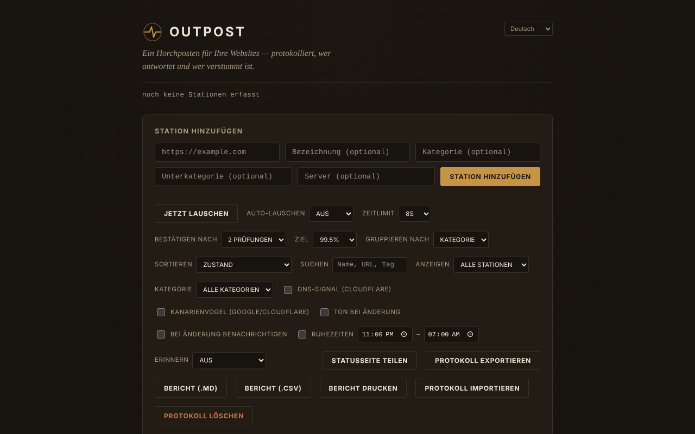

# OUTPOST

[English](README.md) · [Română](README.ro.md) · [Français](README.fr.md) · [Italiano](README.it.md) · [Español](README.es.md) · [Português](README.pt.md) · **Deutsch** · [Magyar](README.hu.md)

**Version:** 2.1.0 · **Zuletzt aktualisiert:** 2026-10-27

Oberflächensprachen: **Română, English, Français, Italiano, Español, Português (PT), Deutsch, Magyar**

Ein Horchposten für deine Websites: ein Erreichbarkeitsmonitor (Reachability) in einer einzigen HTML-Datei, der nur im Browser läuft.

**Online-Anwendung:** https://chiuta.github.io/OUTPOST/

## Was es ist

OUTPOST prüft aus deinem Browser, ob die von dir hinzugefügten Websites „antworten“, führt die Historie der Prüfungen und Ausfälle und zeigt dir einen Status pro Station („Contact“, „Silent“, „Faint“). Es gibt keinen Server, kein Konto und keine Telemetrie; die Liste der Stationen und das Protokoll bleiben im `localStorage` deines Browsers. Beim ersten Öffnen ist die Liste leer (mit einem Klick kannst du drei Beispielstationen hinzufügen).

Die Oberfläche der Anwendung hat 8 Sprachen (RO, EN, FR, IT, ES, PT, DE, HU).

## Funktionen

Im Code und, wo möglich, in automatisierten Tests geprüft (Headless-Chromium, simuliertes Netzwerk):
- Stationen hinzufügen (URL, Bezeichnung, Kategorie, Unterkategorie, Server), Gruppierung nach Kategorie oder Server, Sortierung (Health, Latenz, Name, zuletzt), Filter „nur Probleme“.
- „Listen now“ + „Auto-listen“ (30 s … 30 min), Timeout 5–30 s, „Confirm after“ 1–3 Prüfungen, bevor eine Station als „Silent“ angezeigt wird.
- Drei Signale: eine `HEAD`-Anfrage mit `mode: no-cors`, eine `favicon.ico`-Probe vom Origin und optional (standardmäßig aus) DNS-Auflösung über Cloudflare DNS-over-HTTPS.
- Ausfallepisoden (Beginn, Ende, Dauer, Notiz), eine orientierende Prognose „typically back within…“, ein 30-Tage-Budget gegenüber einem Uptime-Ziel, ein „Health“-Wert.
- Wartungsfenster (30 min … „bis ich sie schließe“), Runbook-artige Notizen pro Station, wiederholte Erinnerung, Ruhezeiten, Ton und Browser-Benachrichtigungen bei Änderungen.
- Ein optionaler „Canary“ (standardmäßig aus): prüft google.com und cloudflare.com, um ein Problem deiner eigenen Verbindung von einem Problem der Stationen zu unterscheiden.
- Export/Import des Protokolls (JSON), „Share status page“ (statischer HTML-Schnappschuss), SVG-Badge pro Station, Synchronisierung zwischen Tabs, Zusammenfassung „While you were away“.
- Feld „Find“: filtert die Liste nach Name, URL, Kategorie, Unterkategorie oder Server (seit 1.1.0 auch unscharf, einschließlich in den Notizen), mit einer ausdrücklichen Meldung, wenn es keine Treffer gibt.
- Validierung mit genauen Meldungen unter dem URL-Feld (Leerzeichen, nicht unterstütztes Schema, ungültiger Host); was du eingegeben hast, bleibt im Feld, wenn die Adresse abgelehnt oder doppelt ist.
- Druckstil: Beim Drucken bleiben nur die Stationen übrig, ohne die Bedienelemente.
- Tastenkürzel: `/` (Feld zum Hinzufügen), `F` (Feld Find; Esc leert es), `L` (listen now), `E` (export); sie werden bei gedrückter Strg-/Alt-/Cmd-Taste nicht ausgelöst (Strg+F bleibt dem Browser vorbehalten).

## Neue Funktionen (1.1.0)

- **Statusbericht**: „Report (.md)“ und „Report (.csv)“ exportieren die Tabelle der Stationen (Zustand, Latenz, Uptime über 24 h / 7 Tage / 30 Tage zeitgewichtet berechnet, letzte Prüfung), die Vorfälle der letzten 30 Tage mit ihren Notizen und die Runbook-Notizen; „Print report“ bereitet ein Blatt für Druck / PDF vor. Der Bericht **enthält keine IP-Adressen**. CSV-Felder, die als Tabellenkalkulationsformeln interpretiert werden könnten, werden durch ein Apostroph entschärft.
- **Tolerantes „Find“**: Neben dem bisherigen wörtlichen Treffer sucht es unscharf (Tippfehler, Diakritika ignoriert) und auch in Runbook-Notizen und Episodennotizen.
- `.fff.json`-Sicherung (gemeinsames Modul „fff-kit“, lokal, ohne Netzwerk): wird über den Dialog geöffnet, der beim Klick auf die Version in der Fußzeile erscheint (Export, passwortverschlüsselter Export, Import mit Bestätigung, Löschen der App-Daten). Die Sicherung enthält den Schlüssel `outpost_state_v1`, **schließt also die aufgelösten IP-Adressen ein**: Behandle sie als privat oder exportiere sie verschlüsselt.
- Die Oberfläche hat 8 Sprachen (RO, EN, FR, IT, ES, PT, DE, HU); die Übersetzungen sind automatisch und nicht von Muttersprachlern geprüft.

## Bedienungsanleitung

1. Öffne die Seite. Anfangs ist die Liste leer; drücke „Add 3 example stations“, um zu sehen, wie es aussieht, oder gib eine URL in „Add a station“ ein und drücke „Add station“.
2. Drücke „Listen now“ (oder wähle „Auto-listen“). Jede Station erhält einen Zustand: „Contact“ (etwas hat geantwortet), „Silent“ (keine Antwort), „Faint“ (widersprüchliche Signale).
3. Öffne „How the listening works“ in der Fußzeile für die Erklärung der Signale.
4. Verwende „Export log“ für eine Sicherung und „Import log“, um die Liste in einen anderen Browser/auf ein anderes Gerät zu übertragen (beim Import kannst du ersetzen oder zusammenführen).
5. „Share status page“ lädt eine statische HTML-Datei ohne Skript herunter, die du überall hochladen kannst.
6. Um das DNS-Signal oder den „Canary“ zu aktivieren, hake sie im Bedienfeld an (siehe unten, was an wen gesendet wird).

## Datenschutz und Netzwerk

- **Lokale Speicherung:** `localStorage`, Schlüssel `outpost_state_v1` (Stationen, Verlauf, Episoden, Notizen, Einstellungen, zuletzt aufgelöste IP-Adressen). Ist der Speicher blockiert, zeigt die Anwendung eine Warnung und arbeitet nur in der aktuellen Sitzung.
- **Mit welchen Websites sie sich verbindet:** beim ersten Öffnen mit keiner. Nachdem du Stationen hinzugefügt hast, sendet dein Browser jeder Station je eine `HEAD`-Anfrage und eine für `/favicon.ico`; die Station sieht deine IP-Adresse, wie bei jedem Besucher.
- **Optional, standardmäßig aus:** „DNS signal“ sendet den Namen jedes Hosts an `cloudflare-dns.com`; „Canary“ kontaktiert `www.google.com` und `www.cloudflare.com` nach jeder Prüfserie. Wenn du sie aktivierst, erhalten diese Dritten deine IP-Adresse und (beim DNS) die Namen der überwachten Hosts.
- Es werden keine Skripte, Schriftarten oder Bilder von anderen Domains geladen. Die Seite hat eine CSP-Richtlinie (`Content-Security-Policy`): Das Skript ist nur auf Grundlage des SHA-256-Hashs des Skripts in der Datei erlaubt (kein `'unsafe-inline'` für Skripte).
- Berechtigungen werden nur angefragt, wenn du sie ankreuzt: Benachrichtigungen (beim Ankreuzen von „Notify on change“), Ton (Web Audio).
- Die exportierte Datei (`outpost-log-*.json`) enthält deine Stationsliste, Notizen und die letzten IPs: Behandle sie als privat.

## Grenzen und Hinweise

- **„Contact“ bedeutet nur, dass auf Netzwerkebene etwas geantwortet hat.** Aus dem Browser lässt sich der HTTP-Code nicht lesen: Eine Fehlerseite (404, 500, 502) oder eine Wartungsseite erscheint trotzdem als „Contact“. „Silent“ kann auch bedeuten, dass das Problem bei dir liegt (Netzwerk, VPN, Blocker-Erweiterung, Firewall) und nicht bei der Website.
- Es prüft weder den Seiteninhalt noch das TLS-Zertifikat noch den Ablauf der Domain.
- Eine über HTTPS ausgelieferte Seite (wie GitHub Pages) kann keine `http://`-Stationen prüfen (gemischter Inhalt wird vom Browser blockiert): Diese werden mit einer Erklärung als „Unlogged“ markiert, nicht als „Silent“. Öffne die Datei lokal (`file://`) für HTTP-Stationen.
- Die Überwachung funktioniert nur, solange der Tab geöffnet ist; Browser drosseln Timer in inaktiven Tabs, und ein gesperrtes Handy prüft nicht. Sie ersetzt keinen serverseitigen Überwachungsdienst.
- Ich habe die Prüfungen nicht an echten Stationen über das Internet getestet; die automatisierten Tests verwendeten ein simuliertes Netzwerk.

## Lokal / offline ausführen

Lade `index.html` herunter und öffne die Datei im Browser. Die Datei selbst braucht kein Internet; die Prüfungen brauchen natürlich Zugriff auf die überwachten Stationen.

## Lizenz

MIT, gemäß der Angabe in der Datei; siehe `LICENSE`.

## Autor

Alexio — Alexandru-Ionuț Chiuță, Kontakt: alexio@trom.tf

## Zusammenfassung

OUTPOST ist ein Erreichbarkeitsmonitor in einer einzigen Datei, nur im Browser (kein Server, kein Konto, keine Telemetrie). Eine frische Installation kontaktiert nichts; sie prüft nur die von dir hinzugefügten Stationen (HEAD-no-cors-Anfrage plus /favicon.ico). Optional, standardmäßig aus: Cloudflare-DNS-over-HTTPS-Abfragen und ein Google/Cloudflare-Canary. „Contact“ bedeutet nur, dass etwas geantwortet hat; HTTP-Statuscodes kann es nicht lesen. Der Zustand liegt in localStorage; importierte Dateien werden validiert. MIT-Lizenz.

## Verlauf / Changelog

### 1.2.4 — 2026-10-22

fff-kit 1.1.4: Touch-Ziele und Mindestschriftgröße; Touch-Ziele und Text korrigiert.

### 1.2.3 — 2026-10-22
- fff-kit 1.1.2: PBKDF2 mit 600.000 Iterationen, Schutz vor Clickjacking

### 1.2.2 — 2026-10-22
- Adressprüfung: Nicht-kanonische IP-Schreibweisen (0x7f000001, 2130706433 …) werden abgelehnt, und private, Loopback-, Link-Local- oder Intranet-Adressen verlangen vor dem Abfragen eine Bestätigung; dieselbe Prüfung gilt beim Import eines Protokolls.
- Die nativen prompt()/confirm()-Dialoge wurden durch barrierefreie, übersetzte Dialoge ersetzt (Notizen, neue Kategorie/Unterkategorie, Löschen, Import: ersetzen oder zusammenführen).
- Ein Hinweis neben der Benachrichtigungs-Einstellung sagt, dass die Überwachung nur läuft, solange der Tab geöffnet bleibt.
- Mobil: kein Text unter 12 px und Touch-Ziele von mindestens 24 px (WCAG 2.5.8).

### 14. Oktober 2026 (v1.1.0)
- Statusbericht (.md, .csv, Druck / PDF) und unscharfes „Find“ (FFF.search), auch in Runbook- und Episodennotizen.
- `.fff.json`-Sicherung über die gemeinsamen Module (core, label, bundle, search); CSP-Richtlinie neu berechnet (der Skript-Hash); neue Tests: `tests/fff-r8.test.mjs`.

### 12. Oktober 2026 (v1.0.0)
- 1.0.0 — 2026-10-12: Die Version und das Datum der letzten Aktualisierung werden in der Anwendung angezeigt

### 11. Oktober 2026
- Ungültige Adressen (mit Leerzeichen oder ohne gültigen Hostnamen, z. B. „not a url !!“) werden jetzt mit „Not a valid URL“ abgelehnt, statt hinzugefügt zu werden.
- Der Inhalt ist in `<main>` eingefasst: 0 axe-Verstöße (landmark, region); der Hintergrund deckt jetzt die gesamte Seitenhöhe ab.
- Feld „Find“, Kürzel `F`, genaue Validierungsmeldungen unter dem URL-Feld (der Text bleibt bei Ablehnung im Feld), Druckstil; die Kürzel ignorieren jetzt Kombinationen mit Strg/Alt/Cmd.
- CSP: `script-src` per SHA-256-Hash, ohne `'unsafe-inline'`.
