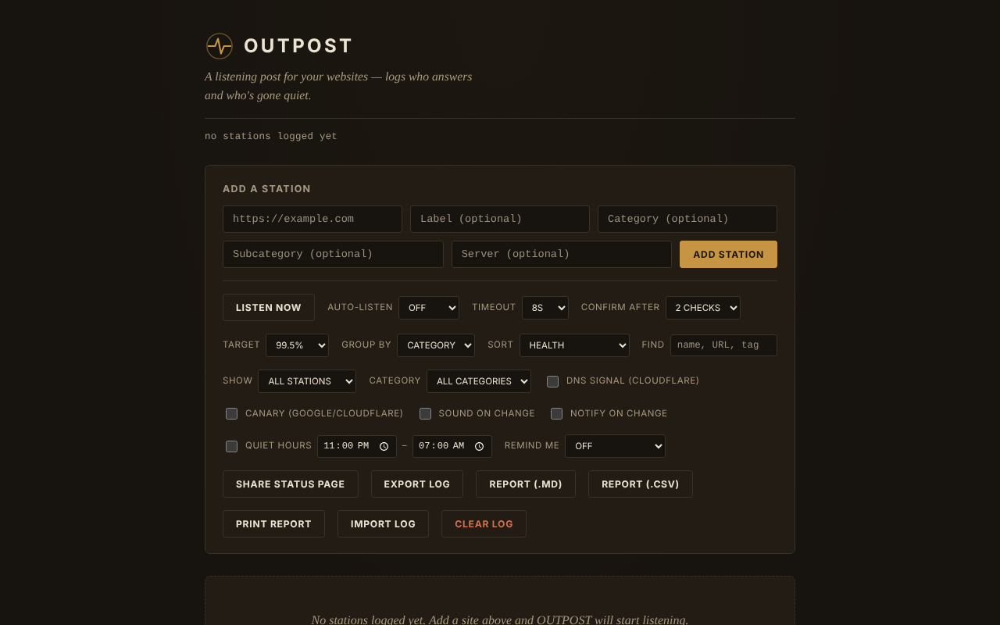

# OUTPOST

[English](README.md) · [Română](README.ro.md) · [Français](README.fr.md) · [Italiano](README.it.md) · **Español** · [Português](README.pt.md) · [Deutsch](README.de.md) · [Magyar](README.hu.md)

**Versión:** 1.2.0 · **Última actualización:** 2026-10-19

Idiomas de la interfaz: **Română, English, Français, Italiano, Español, Português (PT), Deutsch, Magyar**

Puesto de escucha para tus sitios: un monitor de accesibilidad (reachability) en un único archivo HTML, que se ejecuta solo en el navegador.

**Aplicación en línea:** https://chiuta.github.io/OUTPOST/

## Qué es

OUTPOST comprueba, desde tu navegador, si los sitios que añades «responden», conserva el historial de comprobaciones y de caídas y te muestra un estado por estación («Contact», «Silent», «Faint»). No hay servidor, cuenta ni telemetría; la lista de estaciones y el registro permanecen en el `localStorage` de tu navegador. Al abrirlo por primera vez la lista está vacía (puedes añadir tres estaciones de ejemplo con un clic).

La interfaz de la aplicación tiene 8 idiomas (RO, EN, FR, IT, ES, PT, DE, HU).

## Funciones

Verificado en el código y, cuando es posible, en pruebas automáticas (Chromium headless, red simulada):
- Adición de estaciones (URL, etiqueta, categoría, subcategoría, servidor), agrupación por categoría o servidor, orden (salud, latencia, nombre, reciente), filtro «solo problemas».
- «Listen now» + «Auto-listen» (30 s … 30 min), tiempo de espera 5–30 s, «Confirm after» 1–3 comprobaciones antes de que una estación se muestre como «Silent».
- Tres señales: una solicitud `HEAD` con `mode: no-cors`, una sonda `favicon.ico` desde el origen y, de forma opcional (desactivada por defecto), resolución DNS mediante Cloudflare DNS-over-HTTPS.
- Episodios de caída (inicio, fin, duración, nota), predicción orientativa «typically back within…», presupuesto de 30 días frente a un objetivo de uptime, puntuación «Health».
- Ventanas de mantenimiento (30 min … «hasta que las cierre yo»), notas tipo runbook por estación, recordatorio repetido, horas de silencio, sonido y notificaciones del navegador ante un cambio.
- «Canary» opcional (desactivado por defecto): comprueba google.com y cloudflare.com para distinguir un problema de tu conexión de uno de las estaciones.
- Exportación/importación del registro (JSON), «Share status page» (instantánea HTML estática), insignia SVG por estación, sincronización entre pestañas, resumen «While you were away».
- Campo «Find»: filtra la lista por nombre, URL, categoría, subcategoría o servidor (desde la 1.1.0 también de forma aproximada, incluso en las notas), con un mensaje explícito cuando no hay coincidencias.
- Validación con mensajes precisos bajo el campo URL (espacios, esquema no admitido, host no válido); lo que escribiste permanece en el campo si la dirección se rechaza o está duplicada.
- Estilo de impresión: al imprimir solo quedan las estaciones, sin los controles.
- Atajos: `/` (campo de añadir), `F` (campo Find; Esc lo vacía), `L` (listen now), `E` (export); no se activan con Ctrl/Alt/Cmd pulsados (Ctrl+F sigue siendo del navegador).

## Novedades (1.1.0)

- **Informe de estado**: «Report (.md)» y «Report (.csv)» exportan la tabla de estaciones (estado, latencia, uptime a 24 h / 7 días / 30 días calculado en el tiempo, última comprobación), los incidentes de los últimos 30 días con sus notas y las notas de runbook; «Print report» prepara una hoja para imprimir / PDF. El informe **no contiene direcciones IP**. Los campos CSV que podrían interpretarse como fórmulas de hoja de cálculo se neutralizan con un apóstrofo.
- **«Find» tolerante**: además de la coincidencia literal anterior, busca de forma aproximada (erratas, diacríticos ignorados) y también en las notas de runbook y en las notas de los episodios.
- Copia de seguridad `.fff.json` (módulo común «fff-kit», local, sin red): se abre desde el diálogo que aparece al hacer clic en la versión del pie de página (exportación, exportación cifrada con contraseña, importación con confirmación, borrado de los datos de la aplicación). La copia incluye la clave `outpost_state_v1`, por lo que **incluye las direcciones IP resueltas**: trátala como privada o expórtala cifrada.
- La interfaz tiene 8 idiomas (RO, EN, FR, IT, ES, PT, DE, HU); las traducciones son automáticas y no están verificadas por hablantes nativos.

## Manual de uso

1. Abre la página. Al principio la lista está vacía; pulsa «Add 3 example stations» para ver cómo queda, o escribe una URL en «Add a station» y pulsa «Add station».
2. Pulsa «Listen now» (o elige «Auto-listen»). Cada estación recibe un estado: «Contact» (algo respondió), «Silent» (no respondió), «Faint» (señales contradictorias).
3. Abre «How the listening works» en el pie de página para ver la explicación de las señales.
4. Usa «Export log» para una copia de seguridad e «Import log» para trasladar la lista a otro navegador/dispositivo (al importar puedes reemplazar o combinar).
5. «Share status page» descarga un archivo HTML estático, sin script, que puedes subir a cualquier sitio.
6. Para activar la señal DNS o el «canary», márcalos en el panel de controles (más abajo se explica qué se envía y a quién).

## Privacidad y red

- **Almacenamiento local:** `localStorage`, clave `outpost_state_v1` (estaciones, historial, episodios, notas, ajustes, últimas direcciones IP resueltas). Si el almacenamiento está bloqueado, la aplicación muestra un aviso y funciona solo durante la sesión actual.
- **A qué sitios se conecta:** al abrirla por primera vez, a ninguno. Después de añadir estaciones, tu navegador envía a cada estación una solicitud `HEAD` y otra para `/favicon.ico`; la estación ve tu dirección IP, como con cualquier visitante.
- **Opcional, desactivado por defecto:** «DNS signal» envía el nombre de cada host a `cloudflare-dns.com`; «Canary» contacta con `www.google.com` y `www.cloudflare.com` tras cada serie de comprobaciones. Si los activas, esos terceros reciben tu dirección IP y (en el caso del DNS) los nombres de los hosts monitorizados.
- No hay scripts, fuentes ni imágenes cargados desde otros dominios. La página tiene una política CSP (`Content-Security-Policy`): el script solo se permite sobre la base del hash SHA-256 del script del archivo (sin `'unsafe-inline'` para scripts).
- Permisos solicitados solo cuando los marcas: notificaciones (al marcar «Notify on change»), sonido (Web Audio).
- El archivo exportado (`outpost-log-*.json`) contiene tu lista de estaciones, las notas y las últimas IP: trátalo como privado.

## Límites y advertencias

- **«Contact» solo significa que algo respondió a nivel de red.** Desde el navegador no se puede leer el código HTTP: una página de error (404, 500, 502) o una página de mantenimiento aparece igualmente como «Contact». «Silent» también puede significar que el problema está de tu lado (red, VPN, extensión de bloqueo, cortafuegos), no en el sitio.
- No comprueba el contenido de la página, el certificado TLS ni la caducidad del dominio.
- Una página servida por HTTPS (como GitHub Pages) no puede comprobar estaciones `http://` (contenido mixto bloqueado por el navegador): estas se marcan «Unlogged» con una explicación, no «Silent». Abre el archivo en local (`file://`) para estaciones HTTP.
- La monitorización funciona solo mientras la pestaña está abierta; los navegadores ralentizan los temporizadores de las pestañas inactivas y un teléfono bloqueado no comprueba. No sustituye un servicio de monitorización en el servidor.
- No he probado las comprobaciones en estaciones reales a través de internet; las pruebas automáticas usaron una red simulada.

## Ejecución local / sin conexión

Descarga `index.html` y ábrelo en el navegador. El archivo en sí no necesita internet; las comprobaciones, naturalmente, necesitan acceso a las estaciones monitorizadas.

## Licencia

MIT, según la declaración del archivo; consulta `LICENSE`.

## Autor

Alexio — Alexandru-Ionuț Chiuță, contacto: alexio@trom.tf

## Resumen

OUTPOST es un monitor de accesibilidad de un solo archivo, solo en el navegador (sin servidor, sin cuenta, sin telemetría). Una instalación nueva no contacta con nada; solo sondea las estaciones que añades (solicitud HEAD no-cors más /favicon.ico). Opcionales, desactivados por defecto: consultas Cloudflare DNS-over-HTTPS y un canary Google/Cloudflare. «Contact» solo significa que algo respondió; no puede leer los códigos de estado HTTP. El estado reside en localStorage; los archivos importados se validan. Licencia MIT.

## Historial / Changelog

### 14 de octubre de 2026 (v1.1.0)
- Informe de estado (.md, .csv, impresión / PDF) y «Find» aproximado (FFF.search), también en las notas de runbook y de episodios.
- Copia de seguridad `.fff.json` mediante los módulos comunes (core, label, bundle, search); política CSP recalculada (el hash del script); pruebas nuevas: `tests/fff-r8.test.mjs`.

### 12 de octubre de 2026 (v1.0.0)
- 1.0.0 — 2026-10-12: la versión y la fecha de la última actualización se muestran en la aplicación

### 11 de octubre de 2026
- Las direcciones no válidas (con espacios o sin un nombre de host válido, p. ej. «not a url !!») se rechazan ahora con «Not a valid URL» en lugar de añadirse.
- El contenido está envuelto en `<main>`: 0 infracciones de axe (landmark, region); el fondo cubre ahora toda la altura de la página.
- Campo «Find», atajo `F`, mensajes de validación precisos bajo el campo URL (el texto permanece en el campo al rechazarse), estilo de impresión; los atajos ignoran ahora las combinaciones con Ctrl/Alt/Cmd.
- CSP: `script-src` mediante hash SHA-256, sin `'unsafe-inline'`.
