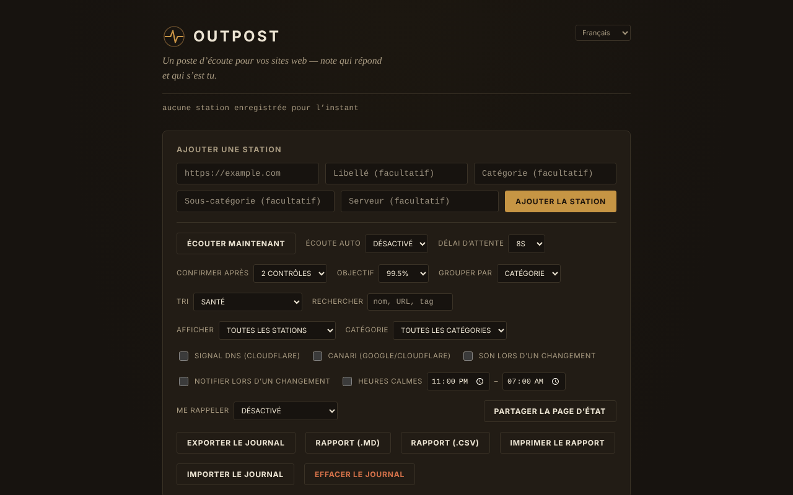

# OUTPOST

[English](README.md) · [Română](README.ro.md) · **Français** · [Italiano](README.it.md) · [Español](README.es.md) · [Português](README.pt.md) · [Deutsch](README.de.md) · [Magyar](README.hu.md)

**Version :** 1.2.4 · **Dernière mise à jour :** 2026-10-22

Langues de l'interface : **Română, English, Français, Italiano, Español, Português (PT), Deutsch, Magyar**

Poste d'écoute pour vos sites : un moniteur d'accessibilité (reachability) dans un seul fichier HTML, qui s'exécute uniquement dans le navigateur.

**Application en ligne :** https://chiuta.github.io/OUTPOST/

## De quoi s'agit-il

OUTPOST vérifie, depuis votre navigateur, si les sites que vous ajoutez « répondent », conserve l'historique des vérifications et des pannes et vous montre un statut par station (« Contact », « Silent », « Faint »). Il n'y a ni serveur, ni compte, ni télémétrie ; la liste des stations et le journal restent dans le `localStorage` de votre navigateur. À la première ouverture, la liste est vide (vous pouvez ajouter trois stations d'exemple en un clic).

L'interface de l'application compte 8 langues (RO, EN, FR, IT, ES, PT, DE, HU).

## Fonctionnalités

Vérifié dans le code et, lorsque c'est possible, dans des tests automatisés (Chromium headless, réseau simulé) :
- Ajout de stations (URL, étiquette, catégorie, sous-catégorie, serveur), regroupement par catégorie ou serveur, tri (santé, latence, nom, récent), filtre « problèmes seulement ».
- « Listen now » + « Auto-listen » (30 s … 30 min), délai d'attente 5–30 s, « Confirm after » 1–3 vérifications avant qu'une station soit affichée comme « Silent ».
- Trois signaux : une requête `HEAD` avec `mode: no-cors`, une sonde `favicon.ico` depuis l'origine et, en option (désactivée par défaut), une résolution DNS via Cloudflare DNS-over-HTTPS.
- Épisodes de panne (début, fin, durée, note), prédiction indicative « typically back within… », budget sur 30 jours par rapport à un objectif de disponibilité, score « Health ».
- Fenêtres de maintenance (30 min … « jusqu'à ce que je les ferme »), notes de type runbook par station, rappel répété, heures de silence, son et notifications du navigateur lors d'un changement.
- « Canary » facultatif (désactivé par défaut) : vérifie google.com et cloudflare.com pour distinguer un problème de votre connexion d'un problème des stations.
- Export/import du journal (JSON), « Share status page » (instantané HTML statique), badge SVG par station, synchronisation entre onglets, résumé « While you were away ».
- Champ « Find » : filtre la liste par nom, URL, catégorie, sous-catégorie ou serveur (depuis la 1.1.0 aussi de façon approximative, y compris dans les notes), avec un message explicite lorsqu'il n'y a aucune correspondance.
- Validation avec des messages précis sous le champ URL (espaces, schéma non pris en charge, hôte invalide) ; ce que vous avez saisi reste dans le champ si l'adresse est rejetée ou en double.
- Style d'impression : à l'impression, seules les stations restent, sans les commandes.
- Raccourcis : `/` (champ d'ajout), `F` (champ Find ; Échap le vide), `L` (listen now), `E` (export) ; ils ne s'activent pas avec Ctrl/Alt/Cmd enfoncés (Ctrl+F reste celui du navigateur).

## Nouveautés (1.1.0)

- **Rapport d'état** : « Report (.md) » et « Report (.csv) » exportent le tableau des stations (état, latence, disponibilité sur 24 h / 7 jours / 30 jours calculée dans le temps, dernière vérification), les incidents des 30 derniers jours avec leurs notes et les notes de runbook ; « Print report » prépare une feuille pour l'impression / PDF. Le rapport **ne contient pas d'adresses IP**. Les champs CSV qui pourraient être interprétés comme des formules de tableur sont neutralisés par une apostrophe.
- **« Find » tolérant** : en plus de la correspondance littérale précédente, recherche approximative (fautes de frappe, diacritiques ignorés) et aussi dans les notes de runbook et les notes d'épisodes.
- Sauvegarde `.fff.json` (module commun « fff-kit », local, sans réseau) : s'ouvre depuis la boîte de dialogue qui apparaît au clic sur la version dans le pied de page (export, export chiffré par mot de passe, import avec confirmation, suppression des données de l'application). La sauvegarde inclut la clé `outpost_state_v1`, donc elle **inclut les adresses IP résolues** : traitez-la comme privée ou exportez-la chiffrée.
- L'interface compte 8 langues (RO, EN, FR, IT, ES, PT, DE, HU) ; les traductions sont automatiques et non vérifiées par des locuteurs natifs.

## Mode d'emploi

1. Ouvrez la page. Au début la liste est vide ; appuyez sur « Add 3 example stations » pour voir à quoi cela ressemble, ou saisissez une URL dans « Add a station » et appuyez sur « Add station ».
2. Appuyez sur « Listen now » (ou choisissez « Auto-listen »). Chaque station reçoit un état : « Contact » (quelque chose a répondu), « Silent » (pas de réponse), « Faint » (signaux contradictoires).
3. Ouvrez « How the listening works » dans le pied de page pour l'explication des signaux.
4. Utilisez « Export log » pour une sauvegarde et « Import log » pour déplacer la liste vers un autre navigateur/appareil (à l'import, vous pouvez remplacer ou fusionner).
5. « Share status page » télécharge un fichier HTML statique, sans script, que vous pouvez publier n'importe où.
6. Pour activer le signal DNS ou le « canary », cochez-les dans le panneau de commandes (voir plus bas ce qui est envoyé et à qui).

## Confidentialité et réseau

- **Stockage local :** `localStorage`, clé `outpost_state_v1` (stations, historique, épisodes, notes, paramètres, dernières adresses IP résolues). Si le stockage est bloqué, l'application affiche un avertissement et ne fonctionne que pour la session en cours.
- **Sites auxquels elle se connecte :** à la première ouverture, à aucun. Après l'ajout de stations, votre navigateur envoie à chaque station une requête `HEAD` et une pour `/favicon.ico` ; la station voit votre adresse IP, comme pour tout visiteur.
- **En option, désactivé par défaut :** « DNS signal » envoie le nom de chaque hôte à `cloudflare-dns.com` ; « Canary » contacte `www.google.com` et `www.cloudflare.com` après chaque série de vérifications. Si vous les activez, ces tiers reçoivent votre adresse IP et (pour le DNS) les noms des hôtes surveillés.
- Aucun script, police ou image n'est chargé depuis d'autres domaines. La page a une politique CSP (`Content-Security-Policy`) : le script n'est autorisé que sur la base du hachage SHA-256 du script du fichier (sans `'unsafe-inline'` pour les scripts).
- Permissions demandées uniquement lorsque vous cochez : notifications (en cochant « Notify on change »), son (Web Audio).
- Le fichier exporté (`outpost-log-*.json`) contient votre liste de stations, les notes et les dernières IP : traitez-le comme privé.

## Limites et avertissements

- **« Contact » signifie seulement que quelque chose a répondu au niveau réseau.** Depuis le navigateur, on ne peut pas lire le code HTTP : une page d'erreur (404, 500, 502) ou une page de maintenance apparaît quand même comme « Contact ». « Silent » peut aussi signifier que le problème est de votre côté (réseau, VPN, extension de blocage, pare-feu), et non celui du site.
- Il ne vérifie ni le contenu de la page, ni le certificat TLS, ni l'expiration du domaine.
- Une page servie en HTTPS (comme GitHub Pages) ne peut pas vérifier des stations `http://` (contenu mixte bloqué par le navigateur) : celles-ci sont marquées « Unlogged » avec une explication, et non « Silent ». Ouvrez le fichier en local (`file://`) pour les stations HTTP.
- La surveillance ne fonctionne que tant que l'onglet est ouvert ; les navigateurs ralentissent les minuteurs des onglets inactifs, et un téléphone verrouillé ne vérifie pas. Elle ne remplace pas un service de surveillance côté serveur.
- Je n'ai pas testé les vérifications sur de vraies stations via internet ; les tests automatisés ont utilisé un réseau simulé.

## Exécution en local / hors ligne

Téléchargez `index.html` et ouvrez-le dans le navigateur. Le fichier lui-même n'a pas besoin d'internet ; les vérifications, bien sûr, ont besoin d'accéder aux stations surveillées.

## Licence

MIT, conformément à la déclaration dans le fichier ; voir `LICENSE`.

## Auteur

Alexio — Alexandru-Ionuț Chiuță, contact : alexio@trom.tf

## Résumé

OUTPOST est un moniteur d'accessibilité monofichier, uniquement dans le navigateur (sans serveur, sans compte, sans télémétrie). Une installation neuve ne contacte rien ; il ne sonde que les stations que vous ajoutez (requête HEAD no-cors plus /favicon.ico). En option, désactivés par défaut : des résolutions Cloudflare DNS-over-HTTPS et un canary Google/Cloudflare. « Contact » signifie seulement que quelque chose a répondu ; il ne peut pas lire les codes d'état HTTP. L'état est conservé dans localStorage ; les fichiers importés sont validés. Licence MIT.

## Historique / Changelog

### 1.2.4 — 2026-10-22

fff-kit 1.1.4 : cibles tactiles et taille de texte minimale; cibles tactiles et texte corrigés.

### 1.2.3 — 2026-10-22
- fff-kit 1.1.2 : PBKDF2 à 600 000 itérations, protection anti-clickjacking

### 1.2.2 — 2026-10-22
- Validation des adresses : les notations IP non canoniques (0x7f000001, 2130706433…) sont refusées, et les adresses privées, de bouclage, link-local ou d'intranet demandent une confirmation avant d'être sondées ; la même vérification s'applique à l'import d'un journal.
- Les boîtes natives prompt()/confirm() sont remplacées par des dialogues accessibles et traduits (notes, nouvelle catégorie/sous-catégorie, effacement, import : remplacer ou fusionner).
- Une note près du réglage des notifications précise que la surveillance ne fonctionne que tant que l'onglet reste ouvert.
- Mobile : aucun texte sous 12 px et cibles tactiles d'au moins 24 px (WCAG 2.5.8).

### 14 octobre 2026 (v1.1.0)
- Rapport d'état (.md, .csv, impression / PDF) et « Find » approximatif (FFF.search), y compris dans les notes de runbook et d'épisodes.
- Sauvegarde `.fff.json` via les modules communs (core, label, bundle, search) ; politique CSP recalculée (le hachage du script) ; nouveaux tests : `tests/fff-r8.test.mjs`.

### 12 octobre 2026 (v1.0.0)
- 1.0.0 — 2026-10-12 : la version et la date de dernière mise à jour sont affichées dans l'application

### 11 octobre 2026
- Les adresses invalides (avec des espaces ou sans nom d'hôte valide, p. ex. « not a url !! ») sont désormais rejetées avec « Not a valid URL » au lieu d'être ajoutées.
- Le contenu est encadré par `<main>` : 0 violation axe (landmark, region) ; le fond couvre désormais toute la hauteur de la page.
- Champ « Find », raccourci `F`, messages de validation précis sous le champ URL (le texte reste dans le champ en cas de rejet), style d'impression ; les raccourcis ignorent désormais les combinaisons avec Ctrl/Alt/Cmd.
- CSP : `script-src` par hachage SHA-256, sans `'unsafe-inline'`.
