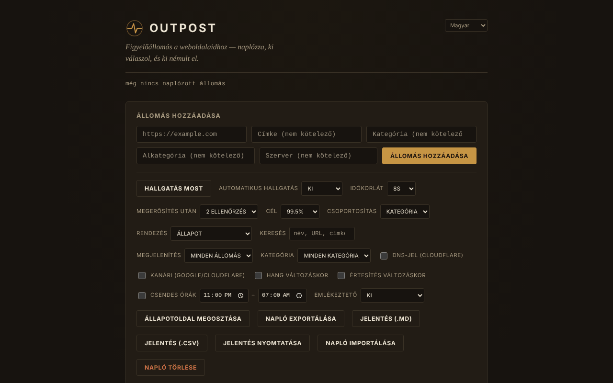

# OUTPOST

[English](README.md) · [Română](README.ro.md) · [Français](README.fr.md) · [Italiano](README.it.md) · [Español](README.es.md) · [Português](README.pt.md) · [Deutsch](README.de.md) · **Magyar**

**Verzió:** 2.0.0 · **Utolsó frissítés:** 2026-10-26

A felület nyelvei: **Română, English, Français, Italiano, Español, Português (PT), Deutsch, Magyar**

Figyelőállomás a webhelyeidhez: elérhetőségi (reachability) monitor egyetlen HTML-fájlban, amely kizárólag a böngészőben fut.

**Online alkalmazás:** https://chiuta.github.io/OUTPOST/

## Mi ez

Az OUTPOST a böngésződből ellenőrzi, hogy a hozzáadott webhelyek „válaszolnak-e”, megőrzi az ellenőrzések és a kiesések előzményeit, és állomásonként mutat egy állapotot („Contact”, „Silent”, „Faint”). Nincs szerver, fiók vagy telemetria; az állomások listája és a napló a böngésződ `localStorage`-ában marad. Az első megnyitáskor a lista üres (egy kattintással hozzáadhatsz három példaállomást).

Az alkalmazás felülete 8 nyelvű (RO, EN, FR, IT, ES, PT, DE, HU).

## Funkciók

A kódban, és ahol lehetséges, automatizált tesztekben ellenőrizve (headless Chromium, szimulált hálózat):
- Állomások hozzáadása (URL, címke, kategória, alkategória, szerver), csoportosítás kategória vagy szerver szerint, rendezés (egészség, késleltetés, név, legutóbbi), „csak problémák” szűrő.
- „Listen now” + „Auto-listen” (30 mp … 30 perc), időkorlát 5–30 mp, „Confirm after” 1–3 ellenőrzés, mielőtt egy állomás „Silent” állapotban jelenik meg.
- Három jel: `HEAD` kérés `mode: no-cors` móddal, `favicon.ico` próba az origintől, valamint opcionálisan (alapértelmezetten kikapcsolva) DNS-feloldás a Cloudflare DNS-over-HTTPS-en keresztül.
- Kiesési epizódok (kezdet, vég, időtartam, megjegyzés), tájékoztató jellegű „typically back within…” előrejelzés, 30 napos keret egy rendelkezésre állási célhoz képest, „Health” pontszám.
- Karbantartási ablakok (30 perc … „amíg be nem zárom”), runbook-jellegű megjegyzések állomásonként, ismételt emlékeztető, csendes órák, hang és böngészőértesítések változáskor.
- Opcionális „Canary” (alapértelmezetten kikapcsolva): ellenőrzi a google.com és a cloudflare.com oldalt, hogy megkülönböztesse a saját kapcsolatod problémáját az állomások problémájától.
- A napló exportja/importja (JSON), „Share status page” (statikus HTML-pillanatkép), SVG-jelvény állomásonként, szinkronizálás a lapok között, „While you were away” összefoglaló.
- „Find” mező: név, URL, kategória, alkategória vagy szerver szerint szűri a listát (az 1.1.0 óta hozzávetőlegesen is, a megjegyzésekben is), kifejezett üzenettel, ha nincs találat.
- Ellenőrzés pontos üzenetekkel az URL-mező alatt (szóközök, nem támogatott séma, érvénytelen gazdagép); amit beírtál, a mezőben marad, ha a címet elutasítja vagy duplikált.
- Nyomtatási stílus: nyomtatáskor csak az állomások maradnak, a vezérlők nélkül.
- Billentyűparancsok: `/` (a hozzáadás mező), `F` (a Find mező; az Esc kiüríti), `L` (listen now), `E` (export); nem aktiválódnak lenyomott Ctrl/Alt/Cmd mellett (a Ctrl+F a böngészőé marad).

## Új funkciók (1.1.0)

- **Állapotjelentés**: a „Report (.md)” és a „Report (.csv)” exportálja az állomások táblázatát (állapot, késleltetés, 24 órás / 7 napos / 30 napos rendelkezésre állás időben számolva, utolsó ellenőrzés), az elmúlt 30 nap incidenseit megjegyzéseikkel, valamint a runbook-megjegyzéseket; a „Print report” nyomtatásra / PDF-re előkészít egy lapot. A jelentés **nem tartalmaz IP-címeket**. Azokat a CSV-mezőket, amelyeket táblázatkezelő-képletként lehetne értelmezni, aposztróf semlegesíti.
- **Toleráns „Find”**: a korábbi szó szerinti egyezés mellett hozzávetőlegesen is keres (elírások, ékezetek figyelmen kívül hagyva), és a runbook-megjegyzésekben és az epizódmegjegyzésekben is.
- `.fff.json` biztonsági mentés (a közös „fff-kit” modul, helyi, hálózat nélkül): a láblécben a verzióra kattintva megjelenő párbeszédablakból nyílik (export, jelszóval titkosított export, import megerősítéssel, az alkalmazás adatainak törlése). A mentés tartalmazza az `outpost_state_v1` kulcsot, tehát **tartalmazza a feloldott IP-címeket is**: kezeld magánjellegűként, vagy titkosítva exportáld.
- A felület 8 nyelvű (RO, EN, FR, IT, ES, PT, DE, HU); a fordítások gépiek, és anyanyelvi beszélők nem ellenőrizték őket.

## Használati útmutató

1. Nyisd meg az oldalt. Eleinte a lista üres; nyomd meg az „Add 3 example stations” gombot, hogy lásd, hogyan néz ki, vagy írj be egy URL-t az „Add a station” mezőbe, és nyomd meg az „Add station” gombot.
2. Nyomd meg a „Listen now” gombot (vagy válaszd az „Auto-listen” lehetőséget). Minden állomás kap egy állapotot: „Contact” (valami válaszolt), „Silent” (nem válaszolt), „Faint” (ellentmondó jelek).
3. Nyisd meg a „How the listening works” részt a láblécben a jelek magyarázatához.
4. Használd az „Export log” gombot biztonsági mentéshez, az „Import log” gombot pedig a lista másik böngészőbe/eszközre átviteléhez (importáláskor lecserélheted vagy egyesítheted).
5. A „Share status page” egy statikus, szkript nélküli HTML-fájlt tölt le, amelyet bárhová feltölthetsz.
6. A DNS-jel vagy a „canary” bekapcsolásához pipáld be őket a vezérlőpanelen (lásd lejjebb, mit küld el és kinek).

## Adatvédelem és hálózat

- **Helyi tárolás:** `localStorage`, `outpost_state_v1` kulcs (állomások, előzmények, epizódok, megjegyzések, beállítások, az utoljára feloldott IP-címek). Ha a tárolás blokkolt, az alkalmazás figyelmeztetést jelenít meg, és csak az aktuális munkamenetben működik.
- **Mely webhelyekhez csatlakozik:** az első megnyitáskor egyikhez sem. Miután állomásokat adtál hozzá, a böngésződ minden állomásnak küld egy `HEAD` kérést és egyet a `/favicon.ico`-ra; az állomás látja az IP-címedet, mint bármely látogatóét.
- **Opcionális, alapértelmezetten kikapcsolva:** a „DNS signal” minden gazdagép nevét elküldi a `cloudflare-dns.com` címre; a „Canary” az ellenőrzések minden sorozata után felveszi a kapcsolatot a `www.google.com` és a `www.cloudflare.com` oldallal. Ha bekapcsolod őket, ezek a harmadik felek megkapják az IP-címedet és (a DNS esetén) a figyelt gazdagépek nevét.
- Nincsenek más tartományokról betöltött szkriptek, betűtípusok vagy képek. Az oldalon CSP-szabály (`Content-Security-Policy`) van érvényben: a szkript csak a fájlban lévő szkript SHA-256 hash-e alapján engedélyezett (a szkriptekhez nincs `'unsafe-inline'`).
- Az engedélyeket csak akkor kéri, amikor bepipálod őket: értesítések (a „Notify on change” bepipálásakor), hang (Web Audio).
- Az exportált fájl (`outpost-log-*.json`) tartalmazza az állomások listáját, a megjegyzéseket és az utolsó IP-címeket: kezeld magánjellegűként.

## Korlátok és figyelmeztetések

- **A „Contact” csak azt jelenti, hogy hálózati szinten valami válaszolt.** A böngészőből nem olvasható ki a HTTP-kód: egy hibaoldal (404, 500, 502) vagy egy karbantartási oldal is „Contact”-ként jelenik meg. A „Silent” azt is jelentheti, hogy a probléma nálad van (hálózat, VPN, blokkoló bővítmény, tűzfal), nem a webhelynél.
- Nem ellenőrzi az oldal tartalmát, a TLS-tanúsítványt vagy a tartomány lejáratát.
- A HTTPS-en kiszolgált oldal (mint a GitHub Pages) nem tud `http://` állomásokat ellenőrizni (a vegyes tartalmat a böngésző blokkolja): ezek magyarázattal „Unlogged”, nem „Silent” jelölést kapnak. HTTP-állomásokhoz nyisd meg a fájlt helyben (`file://`).
- A megfigyelés csak addig működik, amíg a lap nyitva van; a böngészők lassítják az inaktív lapok időzítőit, a zárolt telefon pedig nem ellenőriz. Nem helyettesíti a kiszolgálóoldali megfigyelőszolgáltatást.
- Az ellenőrzéseket nem teszteltem valódi állomásokon az interneten át; az automatizált tesztek szimulált hálózatot használtak.

## Futtatás helyben / offline

Töltsd le az `index.html` fájlt, és nyisd meg a böngészőben. Maga a fájl nem igényel internetet; az ellenőrzésekhez természetesen szükséges a figyelt állomások elérése.

## Licenc

MIT, a fájlban szereplő nyilatkozat szerint; lásd a `LICENSE` fájlt.

## Szerző

Alexio — Alexandru-Ionuț Chiuță, kapcsolat: alexio@trom.tf

## Összefoglaló

Az OUTPOST egyetlen fájlból álló, kizárólag böngészőben futó elérhetőségi monitor (szerver, fiók és telemetria nélkül). Egy friss telepítés semmivel nem veszi fel a kapcsolatot; csak az általad hozzáadott állomásokat vizsgálja (HEAD no-cors kérés plusz /favicon.ico). Opcionális, alapértelmezetten kikapcsolva: Cloudflare DNS-over-HTTPS lekérdezések és egy Google/Cloudflare canary. A „Contact” csak azt jelenti, hogy valami válaszolt; a HTTP-állapotkódokat nem tudja kiolvasni. Az állapot a localStorage-ban él; az importált fájlokat érvényesíti. MIT licenc.

## Előzmények / Changelog

### 1.2.4 — 2026-10-22

fff-kit 1.1.4: érintési célok és minimális szövegméret; érintési célok és szöveg javítva.

### 1.2.3 — 2026-10-22
- fff-kit 1.1.2: PBKDF2 600 000 iterációval, clickjacking elleni védelem

### 1.2.2 — 2026-10-22
- Címellenőrzés: a nem kanonikus IP-jelöléseket (0x7f000001, 2130706433…) elutasítja, a privát, visszacsatolási, link-local vagy intranetes címek pedig megerősítést kérnek a szondázás előtt; ugyanez az ellenőrzés fut naplóimportáláskor is.
- A natív prompt()/confirm() ablakokat akadálymentes, lefordított párbeszédablakok váltották fel (jegyzetek, új kategória/alkategória, törlés, import: csere vagy egyesítés).
- A értesítési beállítás melletti megjegyzés jelzi, hogy a figyelés csak addig fut, amíg a lap nyitva van.
- Mobil: nincs 12 px alatti szöveg, az érintési célpontok legalább 24 px-esek (WCAG 2.5.8).

### 2026. október 14. (v1.1.0)
- Állapotjelentés (.md, .csv, nyomtatás / PDF) és hozzávetőleges „Find” (FFF.search), a runbook- és epizódmegjegyzésekben is.
- `.fff.json` biztonsági mentés a közös modulokon keresztül (core, label, bundle, search); a CSP-szabály újraszámolva (a szkript hash-e); új tesztek: `tests/fff-r8.test.mjs`.

### 2026. október 12. (v1.0.0)
- 1.0.0 — 2026-10-12: a verzió és az utolsó frissítés dátuma megjelenik az alkalmazásban

### 2026. október 11.
- Az érvénytelen címeket (szóközökkel vagy érvényes gazdagépnév nélkül, pl. „not a url !!”) most „Not a valid URL” üzenettel elutasítja, ahelyett hogy hozzáadná őket.
- A tartalom `<main>` elembe van foglalva: 0 axe-hiba (landmark, region); a háttér most az oldal teljes magasságát lefedi.
- „Find” mező, az `F` billentyűparancs, pontos ellenőrzési üzenetek az URL-mező alatt (elutasításkor a szöveg a mezőben marad), nyomtatási stílus; a billentyűparancsok most figyelmen kívül hagyják a Ctrl/Alt/Cmd kombinációkat.
- CSP: `script-src` SHA-256 hash alapján, `'unsafe-inline'` nélkül.
