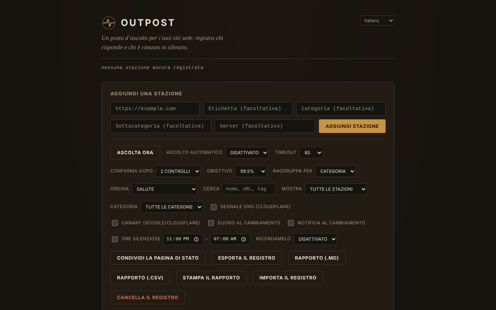

# OUTPOST

[English](README.md) · [Română](README.ro.md) · [Français](README.fr.md) · **Italiano** · [Español](README.es.md) · [Português](README.pt.md) · [Deutsch](README.de.md) · [Magyar](README.hu.md)

**Versione:** 1.2.1 · **Ultimo aggiornamento:** 2026-10-19

Lingue dell'interfaccia: **Română, English, Français, Italiano, Español, Português (PT), Deutsch, Magyar**

Postazione di ascolto per i tuoi siti: un monitor di raggiungibilità (reachability) in un unico file HTML, che funziona solo nel browser.

**Applicazione online:** https://chiuta.github.io/OUTPOST/

## Che cos'è

OUTPOST verifica, dal tuo browser, se i siti che aggiungi «rispondono», conserva la cronologia dei controlli e dei disservizi e ti mostra uno stato per ogni stazione («Contact», «Silent», «Faint»). Non ci sono server, account o telemetria; l'elenco delle stazioni e il registro restano nel `localStorage` del tuo browser. Alla prima apertura l'elenco è vuoto (puoi aggiungere tre stazioni di esempio con un clic).

L'interfaccia dell'applicazione ha 8 lingue (RO, EN, FR, IT, ES, PT, DE, HU).

## Funzionalità

Verificato nel codice e, dove possibile, in test automatici (Chromium headless, rete simulata):
- Aggiunta di stazioni (URL, etichetta, categoria, sottocategoria, server), raggruppamento per categoria o server, ordinamento (salute, latenza, nome, recenti), filtro «solo problemi».
- «Listen now» + «Auto-listen» (30 s … 30 min), timeout 5–30 s, «Confirm after» 1–3 controlli prima che una stazione venga mostrata come «Silent».
- Tre segnali: una richiesta `HEAD` con `mode: no-cors`, una sonda `favicon.ico` dall'origine e, facoltativamente (disattivata per impostazione predefinita), la risoluzione DNS tramite Cloudflare DNS-over-HTTPS.
- Episodi di disservizio (inizio, fine, durata, nota), previsione indicativa «typically back within…», budget a 30 giorni rispetto a un obiettivo di uptime, punteggio «Health».
- Finestre di manutenzione (30 min … «finché non le chiudo io»), note in stile runbook per stazione, promemoria ripetuto, ore di silenzio, suono e notifiche del browser al cambiamento.
- «Canary» facoltativo (disattivato per impostazione predefinita): controlla google.com e cloudflare.com per distinguere un problema della tua connessione da uno delle stazioni.
- Esportazione/importazione del registro (JSON), «Share status page» (istantanea HTML statica), badge SVG per stazione, sincronizzazione tra schede, riepilogo «While you were away».
- Campo «Find»: filtra l'elenco per nome, URL, categoria, sottocategoria o server (dalla 1.1.0 anche in modo approssimato, comprese le note), con un messaggio esplicito quando non ci sono corrispondenze.
- Validazione con messaggi precisi sotto il campo URL (spazi, schema non supportato, host non valido); quanto hai scritto resta nel campo se l'indirizzo è respinto o duplicato.
- Stile di stampa: in stampa restano solo le stazioni, senza i comandi.
- Scorciatoie: `/` (campo di aggiunta), `F` (campo Find; Esc lo svuota), `L` (listen now), `E` (export); non si attivano con Ctrl/Alt/Cmd premuti (Ctrl+F resta quello del browser).

## Novità (1.1.0)

- **Rapporto di stato**: «Report (.md)» e «Report (.csv)» esportano la tabella delle stazioni (stato, latenza, uptime a 24 h / 7 giorni / 30 giorni calcolato nel tempo, ultimo controllo), gli incidenti degli ultimi 30 giorni con le relative note e le note di runbook; «Print report» prepara un foglio per la stampa / PDF. Il rapporto **non contiene indirizzi IP**. I campi CSV che potrebbero essere interpretati come formule di foglio di calcolo sono neutralizzati con un apostrofo.
- **«Find» tollerante**: oltre alla precedente corrispondenza letterale, cerca in modo approssimato (errori di battitura, segni diacritici ignorati) e anche nelle note di runbook e nelle note degli episodi.
- Copia di riserva `.fff.json` (modulo comune «fff-kit», locale, senza rete): si apre dalla finestra che appare facendo clic sulla versione nel piè di pagina (esportazione, esportazione cifrata con password, importazione con conferma, cancellazione dei dati dell'applicazione). La copia comprende la chiave `outpost_state_v1`, quindi **include gli indirizzi IP risolti**: trattala come privata o esportala cifrata.
- L'interfaccia ha 8 lingue (RO, EN, FR, IT, ES, PT, DE, HU); le traduzioni sono automatiche e non verificate da madrelingua.

## Guida all'uso

1. Apri la pagina. All'inizio l'elenco è vuoto; premi «Add 3 example stations» per vedere come appare, oppure scrivi un URL in «Add a station» e premi «Add station».
2. Premi «Listen now» (o scegli «Auto-listen»). Ogni stazione riceve uno stato: «Contact» (qualcosa ha risposto), «Silent» (nessuna risposta), «Faint» (segnali contraddittori).
3. Apri «How the listening works» nel piè di pagina per la spiegazione dei segnali.
4. Usa «Export log» per una copia di riserva e «Import log» per spostare l'elenco su un altro browser/dispositivo (all'importazione puoi sostituire o unire).
5. «Share status page» scarica un file HTML statico, senza script, che puoi caricare ovunque.
6. Per attivare il segnale DNS o il «canary», spuntali nel pannello dei comandi (vedi sotto cosa viene inviato e a chi).

## Privacy e rete

- **Archiviazione locale:** `localStorage`, chiave `outpost_state_v1` (stazioni, cronologia, episodi, note, impostazioni, ultimi indirizzi IP risolti). Se l'archiviazione è bloccata, l'applicazione mostra un avviso e funziona solo per la sessione corrente.
- **A quali siti si connette:** alla prima apertura, a nessuno. Dopo che hai aggiunto le stazioni, il tuo browser invia a ciascuna una richiesta `HEAD` e una per `/favicon.ico`; la stazione vede il tuo indirizzo IP, come con qualsiasi visitatore.
- **Facoltativo, disattivato per impostazione predefinita:** «DNS signal» invia il nome di ciascun host a `cloudflare-dns.com`; «Canary» contatta `www.google.com` e `www.cloudflare.com` dopo ogni serie di controlli. Se li attivi, quelle terze parti ricevono il tuo indirizzo IP e (per il DNS) i nomi degli host monitorati.
- Non ci sono script, font o immagini caricati da altri domini. La pagina ha una policy CSP (`Content-Security-Policy`): lo script è consentito solo sulla base dell'hash SHA-256 dello script nel file (senza `'unsafe-inline'` per gli script).
- Permessi richiesti solo quando li spunti: notifiche (spuntando «Notify on change»), suono (Web Audio).
- Il file esportato (`outpost-log-*.json`) contiene il tuo elenco di stazioni, le note e gli ultimi IP: trattalo come privato.

## Limiti e avvertenze

- **«Contact» significa solo che qualcosa ha risposto a livello di rete.** Dal browser non si può leggere il codice HTTP: una pagina di errore (404, 500, 502) o una pagina di manutenzione compare comunque come «Contact». «Silent» può significare anche che il problema è da parte tua (rete, VPN, estensione di blocco, firewall), non del sito.
- Non verifica il contenuto della pagina, il certificato TLS o la scadenza del dominio.
- Una pagina servita via HTTPS (come GitHub Pages) non può controllare stazioni `http://` (contenuto misto bloccato dal browser): queste sono contrassegnate «Unlogged» con una spiegazione, non «Silent». Apri il file in locale (`file://`) per le stazioni HTTP.
- Il monitoraggio funziona solo finché la scheda è aperta; i browser rallentano i timer nelle schede inattive e un telefono bloccato non effettua controlli. Non sostituisce un servizio di monitoraggio lato server.
- Non ho testato i controlli su stazioni reali via internet; i test automatici hanno usato una rete simulata.

## Esecuzione in locale / offline

Scarica `index.html` e aprilo nel browser. Il file in sé non ha bisogno di internet; i controlli, ovviamente, hanno bisogno di accesso alle stazioni monitorate.

## Licenza

MIT, secondo la dichiarazione nel file; vedi `LICENSE`.

## Autore

Alexio — Alexandru-Ionuț Chiuță, contatto: alexio@trom.tf

## Riepilogo

OUTPOST è un monitor di raggiungibilità in un unico file, solo nel browser (senza server, senza account, senza telemetria). Una nuova installazione non contatta nulla; sonda solo le stazioni che aggiungi (richiesta HEAD no-cors più /favicon.ico). Facoltativi, disattivati per impostazione predefinita: risoluzioni Cloudflare DNS-over-HTTPS e un canary Google/Cloudflare. «Contact» significa solo che qualcosa ha risposto; non può leggere i codici di stato HTTP. Lo stato risiede in localStorage; i file importati vengono validati. Licenza MIT.

## Cronologia / Changelog

### 14 ottobre 2026 (v1.1.0)
- Rapporto di stato (.md, .csv, stampa / PDF) e «Find» approssimato (FFF.search), comprese le note di runbook e degli episodi.
- Copia di riserva `.fff.json` tramite i moduli comuni (core, label, bundle, search); policy CSP ricalcolata (l'hash dello script); nuovi test: `tests/fff-r8.test.mjs`.

### 12 ottobre 2026 (v1.0.0)
- 1.0.0 — 2026-10-12: la versione e la data dell'ultimo aggiornamento sono mostrate nell'applicazione

### 11 ottobre 2026
- Gli indirizzi non validi (con spazi o senza un nome host valido, ad es. «not a url !!») sono ora respinti con «Not a valid URL» invece di essere aggiunti.
- Il contenuto è racchiuso in `<main>`: 0 violazioni axe (landmark, region); lo sfondo ora copre tutta l'altezza della pagina.
- Campo «Find», scorciatoia `F`, messaggi di validazione precisi sotto il campo URL (il testo resta nel campo in caso di rifiuto), stile di stampa; le scorciatoie ora ignorano le combinazioni con Ctrl/Alt/Cmd.
- CSP: `script-src` tramite hash SHA-256, senza `'unsafe-inline'`.
