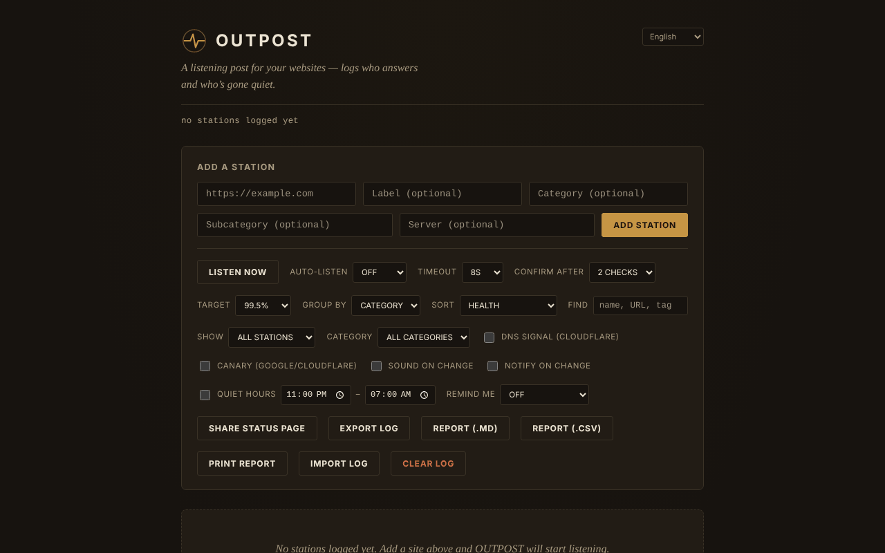

# OUTPOST

**English** · [Română](README.ro.md) · [Français](README.fr.md) · [Italiano](README.it.md) · [Español](README.es.md) · [Português](README.pt.md) · [Deutsch](README.de.md) · [Magyar](README.hu.md)

**Version:** 2.2.0 · **Last updated:** 2026-10-27

**Status:** stable (checks tested only on a simulated network). **Offline:** the app and its log work offline; checking stations needs internet (optional: Cloudflare DNS-over-HTTPS and the Canary, off by default).

Interface languages: **Română, English, Français, Italiano, Español, Português (PT), Deutsch, Magyar**

A listening post for your sites: a reachability monitor in a single HTML file that runs only in the browser.

**Live app:** https://chiuta.github.io/OUTPOST/

## What it is

OUTPOST checks, from your browser, whether the sites you add "respond", keeps the history of checks and outages and shows you a status per station ("Contact", "Silent", "Faint"). There is no server, account or telemetry; the list of stations and the log stay in your browser's `localStorage`. On first opening the list is empty (you can add three example stations with one click).

The app's interface has 8 languages (RO, EN, FR, IT, ES, PT, DE, HU).

## Features

Verified in the code and, where possible, in automated tests (headless Chromium, simulated network):
- Adding stations (URL, label, category, subcategory, server), grouping by category or server, sorting (health, latency, name, recent), "problems only" filter.
- "Listen now" + "Auto-listen" (30 s … 30 min), timeout 5–30 s, "Confirm after" 1–3 checks before a station is shown as "Silent".
- Three signals: a `HEAD` request with `mode: no-cors`, a `favicon.ico` probe from the origin, and, optionally (off by default), DNS resolution through Cloudflare DNS-over-HTTPS.
- Outage episodes (start, end, duration, note), an indicative "typically back within…" prediction, a 30-day budget against an uptime target, a "Health" score.
- Maintenance windows (30 min … "until I close it"), runbook-style notes per station, repeated reminder, quiet hours, sound and browser notifications on change.
- An optional "Canary" (off by default): checks google.com and cloudflare.com to tell a problem of your own connection from one of the stations.
- Log export/import (JSON), "Share status page" (static HTML snapshot), SVG badge per station, synchronisation between tabs, "While you were away" summary.
- "Find" field: filters the list by name, URL, category, subcategory or server (since 1.1.0 also approximately, including in notes), with an explicit message when there are no matches.
- Validation with precise messages under the URL field (spaces, unsupported scheme, invalid host); what you typed stays in the field if the address is rejected or duplicated.
- Print style: when printing, only the stations remain, without the controls.
- Shortcuts: `/` (the add field), `F` (the Find field; Esc clears it), `L` (listen now), `E` (export); they are not triggered with Ctrl/Alt/Cmd pressed (Ctrl+F stays the browser's).
- **Public status page (2.0.0):** “Public status page (30 days)” generates a static, script-free HTML file with a strict CSP: overall state, per-station 30-day daily bars (UTC), 30-day uptime and an incident list, plus a SHA-256 line. Options: hide URLs, include incident notes (off by default). It is a snapshot and does not update by itself.
- **Prometheus metrics and slow alert (2.0.0):** “Metrics (Prometheus)” downloads a text-format `.prom` file (usable with the textfile collector); “Slow alert” warns locally (toast, sound, notification) after two consecutive readings over the limit and when back under it.
- **Limits stated in the app (2.1.0):** a visible panel, “Limits of in-browser monitoring”, open while the list is empty (collapsed once stations exist): monitoring works only while the tab is open (closed tab, locked phone or throttled background timers = no checks); CORS makes the answer “something responded”, not an HTTP status; “Silent” may be a local problem; and, importantly, **uptime percentages cover the whole time since the station was added, and periods with the tab closed count as “up” (except an outage already open), so they can overstate availability**. A short note also appears next to “Auto-listen” when it is on.
- **Sound test (2.1.0):** a “Test sound” button plays the low tone (“Silent”) and then the high tone (“Contact”), ignoring quiet hours. Sound and notifications on change already existed.
- **Uptime history (2.1.0):** every station has a collapsible “Uptime history (30 days)” with one bar per UTC day (green = no outage, amber ≥ 95%, red < 95%, grey = not monitored) and the 30-day percentage, computed from the same outage episodes as the public status page. Open/closed state is kept across refreshes.

## New features (1.1.0)

- **Status report**: "Report (.md)" and "Report (.csv)" export the table of stations (state, latency, uptime over 24 h / 7 days / 30 days computed over time, last check), the incidents of the last 30 days with their notes, and the runbook notes; "Print report" prepares a sheet for printing / PDF. The report **does not contain IP addresses**. CSV fields that could be interpreted as spreadsheet formulas are neutralised with an apostrophe.
- **Tolerant "Find"**: besides the old literal match, it searches approximately (typos, diacritics ignored) and also in runbook notes and episode notes.
- `.fff.json` backup (the shared module "fff-kit", local, no network): opened from the dialog that appears on clicking the version in the footer (export, password-encrypted export, import with confirmation, deletion of the app's data). The backup includes the key `outpost_state_v1`, so it **includes the resolved IP addresses**: treat it as private or export it encrypted.
- The interface has 8 languages (RO, EN, FR, IT, ES, PT, DE, HU); the translations are automatic and not verified by native speakers.

## User guide

1. Open the page. At first the list is empty; press "Add 3 example stations" to see how it looks, or type a URL into "Add a station" and press "Add station".
2. Press "Listen now" (or choose "Auto-listen"). Each station gets a state: "Contact" (something answered), "Silent" (no answer), "Faint" (contradictory signals).
3. Open "How the listening works" in the footer for an explanation of the signals.
4. Use "Export log" for a backup and "Import log" to move the list to another browser/device (on import you can replace or merge).
5. "Share status page" downloads a static HTML file, with no script, that you can upload anywhere.
6. To enable the DNS signal or the "canary", tick them in the control panel (see below what is sent and to whom).

## Privacy and network

- **Local storage:** `localStorage`, key `outpost_state_v1` (stations, history, episodes, notes, settings, the last resolved IP addresses). If storage is blocked, the app shows a warning and works only for the current session.
- **Which sites it connects to:** on first opening, to none. After you add stations, your browser sends each station one `HEAD` request and one for `/favicon.ico`; the station sees your IP address, as with any visitor.
- **Optional, off by default:** "DNS signal" sends the name of each host to `cloudflare-dns.com`; "Canary" contacts `www.google.com` and `www.cloudflare.com` after each series of checks. If you enable them, those third parties receive your IP address and (for DNS) the names of the monitored hosts.
- There are no scripts, fonts or images loaded from other domains. The page has a CSP policy (`Content-Security-Policy`): the script is allowed only on the basis of the SHA-256 hash of the script in the file (no `'unsafe-inline'` for scripts).
- Permissions requested only when you tick them: notifications (when ticking "Notify on change"), sound (Web Audio).
- The exported file (`outpost-log-*.json`) contains your list of stations, notes and the latest IPs: treat it as private.

## Limits and warnings

- **"Contact" only means that something answered at the network level.** From the browser the HTTP code cannot be read: an error page (404, 500, 502) or a maintenance page still appears as "Contact". "Silent" can also mean that the problem is on your side (network, VPN, blocking extension, firewall), not the site's.
- It does not check the page content, the TLS certificate or the domain expiry.
- A page served over HTTPS (like GitHub Pages) cannot check `http://` stations (mixed content blocked by the browser): these are marked "Unlogged" with an explanation, not "Silent". Open the file locally (`file://`) for HTTP stations.
- Monitoring works only while the tab is open; browsers slow down timers in inactive tabs, and a locked phone does not check. It does not replace a server-side monitoring service.
- I have not tested the checks on real stations over the internet; the automated tests used a simulated network.

## Running locally / offline

Download `index.html` and open it in the browser. The file itself does not need internet; the checks, of course, need access to the monitored stations.

## License

MIT, as declared in the file; see `LICENSE`.

## Author

Alexio — Alexandru-Ionuț Chiuță, contact: alexio@trom.tf

## Summary

OUTPOST is a single-file, browser-only reachability monitor (no server, no account, no telemetry). A fresh install contacts nothing; it only probes the stations you add (HEAD no-cors request plus /favicon.ico). Optional, off by default: Cloudflare DNS-over-HTTPS lookups and a Google/Cloudflare canary. "Contact" only means that something answered; it cannot read HTTP status codes. State lives in localStorage; imported files are validated. MIT licence.

## History / Changelog

- 2.1.0 — 2026-10-27: limits panel, sound test, 30-day uptime history, status/offline lines, `CHANGELOG.md`. Previously: v2.0.0.

### 1.2.4 — 2026-10-22

fff-kit 1.1.4: touch targets and minimum text size; touch targets and text size corrected.

### 1.2.3 — 2026-10-22
- fff-kit 1.1.2: PBKDF2 600,000 iterations, anti-clickjacking protection

### 1.2.2 — 2026-10-22
- Address validation: non-canonical IP notations (0x7f000001, 2130706433…) are rejected, and private, loopback, link-local or intranet addresses now ask for confirmation before being probed; the same check runs when importing a log.
- The native prompt()/confirm() boxes were replaced by accessible, translated dialogs (notes, new category/subcategory, clearing, import: replace or merge).
- A note next to the notification setting says monitoring only runs while the tab stays open.
- Mobile: no text below 12 px and touch targets of at least 24 px (WCAG 2.5.8).

### 14 October 2026 (v1.1.0)
- Status report (.md, .csv, print / PDF) and approximate "Find" (FFF.search), including in runbook notes and episode notes.
- `.fff.json` backup through the shared modules (core, label, bundle, search); CSP policy recalculated (the script hash); new tests: `tests/fff-r8.test.mjs`.

### 12 October 2026 (v1.0.0)
- 1.0.0 — 2026-10-12: the version and the date of the last update are shown in the app

### 11 October 2026
- Invalid addresses (with spaces or without a valid host name, e.g. "not a url !!") are now rejected with "Not a valid URL" instead of being added.
- The content is wrapped in `<main>`: 0 axe violations (landmark, region); the background now covers the full page height.
- "Find" field, the `F` shortcut, precise validation messages under the URL field (the text stays in the field on rejection), print style; the shortcuts now ignore combinations with Ctrl/Alt/Cmd.
- CSP: `script-src` by SHA-256 hash, without `'unsafe-inline'`.

## Monitoring coverage (2.2.0)

The “Uptime history (30 days)” of each station now also shows how much of the time the tab was open (a heartbeat about every minute; a gap over 5 minutes starts a new interval), with a warning that outages while the tab is closed are not recorded. Counting starts the first time 2.2.0 is opened (the past cannot be reconstructed), is stored in a separate key `outpost_watch_v1` (not part of the log export), and the line appears after at least one hour of data. The existing uptime percentages are unchanged; the coverage explains how far they can be trusted. Translations of the new text: RO and EN written, the others automatic.
