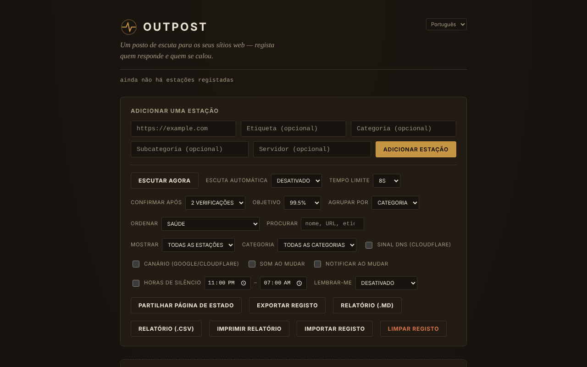

# OUTPOST

[English](README.md) · [Română](README.ro.md) · [Français](README.fr.md) · [Italiano](README.it.md) · [Español](README.es.md) · **Português** · [Deutsch](README.de.md) · [Magyar](README.hu.md)

**Versão:** 1.2.4 · **Última atualização:** 2026-10-22

Idiomas da interface: **Română, English, Français, Italiano, Español, Português (PT), Deutsch, Magyar**

Posto de escuta para os seus sites: um monitor de acessibilidade (reachability) num único ficheiro HTML, que funciona apenas no navegador.

**Aplicação online:** https://chiuta.github.io/OUTPOST/

## O que é

O OUTPOST verifica, a partir do seu navegador, se os sites que adiciona «respondem», guarda o histórico das verificações e das quedas e mostra-lhe um estado por estação («Contact», «Silent», «Faint»). Não há servidor, conta nem telemetria; a lista de estações e o registo ficam no `localStorage` do seu navegador. Na primeira abertura a lista está vazia (pode adicionar três estações de exemplo com um clique).

A interface da aplicação tem 8 idiomas (RO, EN, FR, IT, ES, PT, DE, HU).

## Funcionalidades

Verificado no código e, quando possível, em testes automáticos (Chromium headless, rede simulada):
- Adição de estações (URL, etiqueta, categoria, subcategoria, servidor), agrupamento por categoria ou servidor, ordenação (saúde, latência, nome, recentes), filtro «apenas problemas».
- «Listen now» + «Auto-listen» (30 s … 30 min), tempo limite 5–30 s, «Confirm after» 1–3 verificações antes de uma estação ser apresentada como «Silent».
- Três sinais: um pedido `HEAD` com `mode: no-cors`, uma sonda `favicon.ico` a partir da origem e, opcionalmente (desativada por predefinição), resolução DNS através do Cloudflare DNS-over-HTTPS.
- Episódios de queda (início, fim, duração, nota), previsão indicativa «typically back within…», orçamento de 30 dias face a um objetivo de uptime, pontuação «Health».
- Janelas de manutenção (30 min … «até eu as fechar»), notas ao estilo runbook por estação, lembrete repetido, horas de silêncio, som e notificações do navegador numa alteração.
- «Canary» opcional (desativado por predefinição): verifica google.com e cloudflare.com para distinguir um problema da sua ligação de um problema das estações.
- Exportação/importação do registo (JSON), «Share status page» (instantâneo HTML estático), emblema SVG por estação, sincronização entre separadores, resumo «While you were away».
- Campo «Find»: filtra a lista por nome, URL, categoria, subcategoria ou servidor (desde a 1.1.0 também de forma aproximada, incluindo nas notas), com uma mensagem explícita quando não há correspondências.
- Validação com mensagens precisas por baixo do campo URL (espaços, esquema não suportado, anfitrião inválido); o que escreveu permanece no campo se o endereço for rejeitado ou duplicado.
- Estilo de impressão: ao imprimir ficam apenas as estações, sem os controlos.
- Atalhos: `/` (campo de adição), `F` (campo Find; Esc esvazia-o), `L` (listen now), `E` (export); não se ativam com Ctrl/Alt/Cmd premidos (Ctrl+F continua a ser do navegador).

## Novidades (1.1.0)

- **Relatório de estado**: «Report (.md)» e «Report (.csv)» exportam a tabela das estações (estado, latência, uptime a 24 h / 7 dias / 30 dias calculado ao longo do tempo, última verificação), os incidentes dos últimos 30 dias com as respetivas notas e as notas de runbook; «Print report» prepara uma folha para impressão / PDF. O relatório **não contém endereços IP**. Os campos CSV que poderiam ser interpretados como fórmulas de folha de cálculo são neutralizados com um apóstrofo.
- **«Find» tolerante**: além da correspondência literal anterior, pesquisa de forma aproximada (gralhas, diacríticos ignorados) e também nas notas de runbook e nas notas dos episódios.
- Cópia de segurança `.fff.json` (módulo comum «fff-kit», local, sem rede): abre-se a partir do diálogo que surge ao clicar na versão do rodapé (exportação, exportação cifrada com palavra-passe, importação com confirmação, eliminação dos dados da aplicação). A cópia inclui a chave `outpost_state_v1`, pelo que **inclui os endereços IP resolvidos**: trate-a como privada ou exporte-a cifrada.
- A interface tem 8 idiomas (RO, EN, FR, IT, ES, PT, DE, HU); as traduções são automáticas e não verificadas por falantes nativos.

## Manual de utilização

1. Abra a página. No início a lista está vazia; prima «Add 3 example stations» para ver como fica, ou escreva um URL em «Add a station» e prima «Add station».
2. Prima «Listen now» (ou escolha «Auto-listen»). Cada estação recebe um estado: «Contact» (algo respondeu), «Silent» (não respondeu), «Faint» (sinais contraditórios).
3. Abra «How the listening works» no rodapé para a explicação dos sinais.
4. Use «Export log» para uma cópia de segurança e «Import log» para mover a lista para outro navegador/dispositivo (na importação pode substituir ou combinar).
5. «Share status page» descarrega um ficheiro HTML estático, sem script, que pode carregar para qualquer lado.
6. Para ativar o sinal DNS ou o «canary», marque-os no painel de controlos (veja abaixo o que é enviado e a quem).

## Privacidade e rede

- **Armazenamento local:** `localStorage`, chave `outpost_state_v1` (estações, histórico, episódios, notas, definições, últimos endereços IP resolvidos). Se o armazenamento estiver bloqueado, a aplicação mostra um aviso e funciona apenas na sessão atual.
- **A que sites se liga:** na primeira abertura, a nenhum. Depois de adicionar estações, o seu navegador envia a cada estação um pedido `HEAD` e outro para `/favicon.ico`; a estação vê o seu endereço IP, como em qualquer visitante.
- **Opcional, desativado por predefinição:** «DNS signal» envia o nome de cada anfitrião para `cloudflare-dns.com`; «Canary» contacta `www.google.com` e `www.cloudflare.com` após cada série de verificações. Se os ativar, esses terceiros recebem o seu endereço IP e (no caso do DNS) os nomes dos anfitriões monitorizados.
- Não há scripts, tipos de letra nem imagens carregados de outros domínios. A página tem uma política CSP (`Content-Security-Policy`): o script só é permitido com base no hash SHA-256 do script do ficheiro (sem `'unsafe-inline'` para scripts).
- Permissões pedidas apenas quando as marca: notificações (ao marcar «Notify on change»), som (Web Audio).
- O ficheiro exportado (`outpost-log-*.json`) contém a sua lista de estações, as notas e os últimos IP: trate-o como privado.

## Limites e avisos

- **«Contact» significa apenas que algo respondeu ao nível da rede.** A partir do navegador não se consegue ler o código HTTP: uma página de erro (404, 500, 502) ou uma página de manutenção aparece na mesma como «Contact». «Silent» pode também significar que o problema está do seu lado (rede, VPN, extensão de bloqueio, firewall), e não no site.
- Não verifica o conteúdo da página, o certificado TLS nem a expiração do domínio.
- Uma página servida por HTTPS (como o GitHub Pages) não pode verificar estações `http://` (conteúdo misto bloqueado pelo navegador): estas são marcadas «Unlogged» com uma explicação, e não «Silent». Abra o ficheiro localmente (`file://`) para estações HTTP.
- A monitorização funciona apenas enquanto o separador estiver aberto; os navegadores abrandam os temporizadores dos separadores inativos, e um telemóvel bloqueado não verifica. Não substitui um serviço de monitorização no servidor.
- Não testei as verificações em estações reais através da internet; os testes automáticos usaram uma rede simulada.

## Execução local / offline

Descarregue `index.html` e abra-o no navegador. O ficheiro em si não precisa de internet; as verificações, naturalmente, precisam de acesso às estações monitorizadas.

## Licença

MIT, conforme a declaração no ficheiro; veja `LICENSE`.

## Autor

Alexio — Alexandru-Ionuț Chiuță, contacto: alexio@trom.tf

## Resumo

O OUTPOST é um monitor de acessibilidade de ficheiro único, apenas no navegador (sem servidor, sem conta, sem telemetria). Uma instalação nova não contacta nada; só sonda as estações que adicionar (pedido HEAD no-cors mais /favicon.ico). Opcionais, desativados por predefinição: consultas Cloudflare DNS-over-HTTPS e um canary Google/Cloudflare. «Contact» significa apenas que algo respondeu; não consegue ler códigos de estado HTTP. O estado reside no localStorage; os ficheiros importados são validados. Licença MIT.

## Histórico / Changelog

### 1.2.4 — 2026-10-22

fff-kit 1.1.4: alvos de toque e tamanho mínimo do texto; alvos de toque e texto corrigidos.

### 1.2.3 — 2026-10-22
- fff-kit 1.1.2: PBKDF2 com 600.000 iterações, proteção anti-clickjacking

### 1.2.2 — 2026-10-22
- Validação de endereços: as notações IP não canónicas (0x7f000001, 2130706433…) são rejeitadas e os endereços privados, de loopback, link-local ou de intranet pedem confirmação antes de serem sondados; a mesma verificação aplica-se ao importar um registo.
- As caixas nativas prompt()/confirm() foram substituídas por diálogos acessíveis e traduzidos (notas, nova categoria/subcategoria, limpeza, importação: substituir ou combinar).
- Uma nota junto à definição das notificações indica que a monitorização só funciona enquanto o separador estiver aberto.
- Telemóvel: nenhum texto abaixo de 12 px e áreas táteis de pelo menos 24 px (WCAG 2.5.8).

### 14 de outubro de 2026 (v1.1.0)
- Relatório de estado (.md, .csv, impressão / PDF) e «Find» aproximado (FFF.search), incluindo nas notas de runbook e de episódios.
- Cópia de segurança `.fff.json` através dos módulos comuns (core, label, bundle, search); política CSP recalculada (o hash do script); novos testes: `tests/fff-r8.test.mjs`.

### 12 de outubro de 2026 (v1.0.0)
- 1.0.0 — 2026-10-12: a versão e a data da última atualização são apresentadas na aplicação

### 11 de outubro de 2026
- Os endereços inválidos (com espaços ou sem um nome de anfitrião válido, p. ex. «not a url !!») são agora rejeitados com «Not a valid URL» em vez de serem adicionados.
- O conteúdo está envolvido em `<main>`: 0 violações axe (landmark, region); o fundo cobre agora toda a altura da página.
- Campo «Find», atalho `F`, mensagens de validação precisas por baixo do campo URL (o texto permanece no campo em caso de rejeição), estilo de impressão; os atalhos ignoram agora as combinações com Ctrl/Alt/Cmd.
- CSP: `script-src` por hash SHA-256, sem `'unsafe-inline'`.
