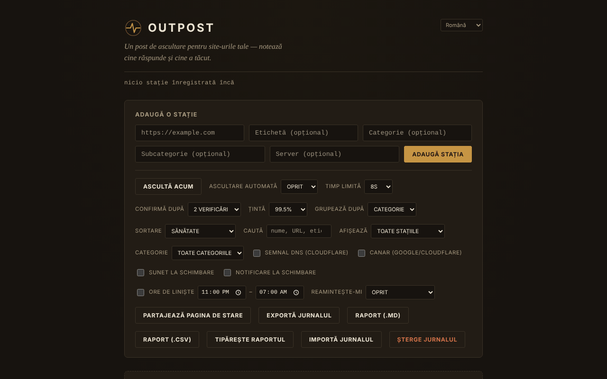

# OUTPOST

[English](README.md) · **Română** · [Français](README.fr.md) · [Italiano](README.it.md) · [Español](README.es.md) · [Português](README.pt.md) · [Deutsch](README.de.md) · [Magyar](README.hu.md)

**Versiune:** 1.2.3 · **Ultima actualizare:** 2026-10-22

Limbile interfeței: **Română, English, Français, Italiano, Español, Português (PT), Deutsch, Magyar**

Post de ascultare pentru site-urile tale: un monitor de accesibilitate (reachability) într-un singur fișier HTML, care rulează numai în browser.

**Live:** https://chiuta.github.io/OUTPOST/

## Ce este

OUTPOST verifică, din browserul tău, dacă site-urile pe care le adaugi „răspund”, păstrează istoricul verificărilor și al căderilor și îți arată un status pe stație („Contact”, „Silent”, „Faint”). Nu există server, cont sau telemetrie; lista de stații și jurnalul rămân în `localStorage`-ul browserului tău. La prima deschidere lista este goală (poți adăuga trei stații-exemplu cu un clic).

Interfața aplicației are 8 limbi (RO, EN, FR, IT, ES, PT, DE, HU).

## Funcții

Verificate în cod și, unde se poate, în teste automate (Chromium headless, rețea simulată):
- Adăugare de stații (URL, etichetă, categorie, subcategorie, server), grupare după categorie sau server, sortare (health, latență, nume, recent), filtru „doar probleme”.
- „Listen now” + „Auto-listen” (30 s … 30 min), timeout 5–30 s, „Confirm after” 1–3 verificări înainte ca o stație să fie afișată ca „Silent”.
- Trei semnale: cerere `HEAD` cu `mode: no-cors`, probă `favicon.ico` de pe origine, iar opțional (dezactivat implicit) rezoluție DNS prin Cloudflare DNS-over-HTTPS.
- Episoade de cădere (început, sfârșit, durată, notă), predicție orientativă „typically back within…”, buget de 30 de zile față de o țintă de uptime, scor „Health”.
- Ferestre de mentenanță (30 min … „până o închid eu”), note de tip runbook per stație, memento repetat, ore de liniște, sunet și notificări de browser la schimbare.
- „Canary” opțional (dezactivat implicit): verifică google.com și cloudflare.com ca să deosebească o problemă a conexiunii tale de una a stațiilor.
- Export/import al jurnalului (JSON), „Share status page” (instantaneu HTML static), insignă SVG per stație, sincronizare între taburi, rezumat „While you were away”.
- Câmp „Find”: filtrează lista după nume, URL, categorie, subcategorie sau server (din 1.1.0 și aproximativ, inclusiv în note), cu mesaj explicit când nu există potriviri.
- Validare cu mesaje precise sub câmpul URL (spații, schemă neacceptată, gazdă invalidă); ce ai scris rămâne în câmp dacă adresa e respinsă sau duplicată.
- Stil de tipărire: la imprimare rămân doar stațiile, fără comenzi.
- Scurtături: `/` (câmpul de adăugare), `F` (câmpul Find; Esc îl golește), `L` (listen now), `E` (export); nu se activează cu Ctrl/Alt/Cmd apăsate (Ctrl+F rămâne al browserului).

## Funcții noi (1.1.0)

- **Raport de stare**: „Report (.md)” și „Report (.csv)” exportă tabelul stațiilor (stare, latență, uptime pe 24 h / 7 zile / 30 de zile calculat pe timp, ultima verificare), incidentele din ultimele 30 de zile cu notele lor și notele de runbook; „Print report” pregătește o foaie pentru tipărire / PDF. Raportul **nu conține adrese IP**. Câmpurile CSV care ar putea fi interpretate ca formule de foaie de calcul sunt neutralizate cu apostrof.
- **„Find” tolerant**: pe lângă potrivirea literală veche, caută aproximativ (greșeli de scriere, diacritice ignorate) și în notele de runbook și notele episoadelor.
- Copie de siguranță `.fff.json` (modul comun „fff-kit”, local, fără rețea): se deschide din dialogul care apare la clic pe versiunea din subsol (export, export criptat cu parolă, import cu confirmare, ștergerea datelor aplicației). Copia cuprinde cheia `outpost_state_v1`, deci **include adresele IP rezolvate**: tratează-o ca privată sau exportă-o criptată.
- Interfața are 8 limbi (RO, EN, FR, IT, ES, PT, DE, HU); traducerile sunt automate și neverificate de vorbitori nativi.

## Manual de utilizare

1. Deschide pagina. La început lista este goală; apasă „Add 3 example stations” ca să vezi cum arată, sau scrie un URL în „Add a station” și apasă „Add station”.
2. Apasă „Listen now” (sau alege „Auto-listen”). Fiecare stație primește o stare: „Contact” (a răspuns ceva), „Silent” (nu a răspuns), „Faint” (semnale contradictorii).
3. Deschide „How the listening works” din subsol pentru explicația semnalelor.
4. Folosește „Export log” pentru copie de rezervă și „Import log” pentru a muta lista pe alt browser/dispozitiv (la import poți înlocui sau îmbina).
5. „Share status page” descarcă un fișier HTML static, fără script, pe care îl poți încărca oriunde.
6. Pentru a activa semnalul DNS sau „canary”, bifează-le în panoul de comenzi (vezi mai jos ce se trimite și cui).

## Confidențialitate și rețea

- **Stocare locală:** `localStorage`, cheia `outpost_state_v1` (stații, istoric, episoade, note, setări, ultimele adrese IP rezolvate). Dacă stocarea e blocată, aplicația afișează un avertisment și funcționează doar în sesiunea curentă.
- **Către ce site-uri se conectează:** la prima deschidere, către niciunul. După ce adaugi stații, browserul tău trimite fiecărei stații câte o cerere `HEAD` și una pentru `/favicon.ico`; stația vede adresa ta IP, ca la orice vizitator.
- **Opțional, dezactivat implicit:** „DNS signal” trimite numele fiecărei gazde la `cloudflare-dns.com`; „Canary” contactează `www.google.com` și `www.cloudflare.com` după fiecare serie de verificări. Dacă le activezi, acei terți primesc adresa ta IP și (pentru DNS) numele gazdelor monitorizate.
- Nu există scripturi, fonturi sau imagini încărcate de pe alte domenii. Pagina are o politică CSP (`Content-Security-Policy`): scriptul este permis doar pe baza hash-ului SHA-256 al scriptului din fișier (fără `'unsafe-inline'` pentru scripturi).
- Permisiuni cerute doar când bifezi: notificări (la bifarea „Notify on change”), sunet (Web Audio).
- Fișierul exportat (`outpost-log-*.json`) conține lista ta de stații, note și ultimele IP-uri: tratează-l ca privat.

## Limite și avertismente

- **„Contact” înseamnă doar că ceva a răspuns la nivel de rețea.** Din browser nu se poate citi codul HTTP: o pagină de eroare (404, 500, 502) sau o pagină de întreținere tot apare ca „Contact”. „Silent” poate însemna și că problema este la tine (rețea, VPN, extensie de blocare, firewall), nu la site.
- Nu verifică conținutul paginii, certificatul TLS sau expirarea domeniului.
- O pagină servită prin HTTPS (ca GitHub Pages) nu poate verifica stații `http://` (conținut mixt blocat de browser): acestea sunt marcate „Unlogged” cu explicație, nu „Silent”. Deschide fișierul local (`file://`) pentru stații HTTP.
- Monitorizarea funcționează doar cât tab-ul este deschis; browserele încetinesc temporizatoarele din taburile inactive, iar telefonul blocat nu verifică. Nu înlocuiește un serviciu de monitorizare pe server.
- Nu am testat verificările pe stații reale prin internet; testele automate au folosit rețea simulată.

## Rulare locală / offline

Descarcă `index.html` și deschide-l în browser. Fișierul în sine nu are nevoie de internet; verificările au, firește, nevoie de acces la stațiile monitorizate.

## Licență

MIT, conform declarației din fișier; vezi `LICENSE`.

## Autor

Alexio — Alexandru-Ionuț Chiuță, contact: alexio@trom.tf

## Rezumat

OUTPOST este un monitor de accesibilitate doar în browser, într-un singur fișier (fără server, fără cont, fără telemetrie). O instalare nouă nu contactează nimic; sondează doar stațiile pe care le adaugi (cerere HEAD no-cors plus /favicon.ico). Opționale, dezactivate implicit: interogări Cloudflare DNS-over-HTTPS și un canar Google/Cloudflare. „Contact” înseamnă doar că ceva a răspuns; nu poate citi codurile de stare HTTP. Starea se păstrează în localStorage; fișierele importate sunt validate. Licență MIT.

## Istoric / Changelog

### 1.2.3 — 2026-10-22
- fff-kit 1.1.2: PBKDF2 600 000 iterații, protecție anti-clickjacking

### 1.2.2 — 2026-10-22
- Validarea adreselor: notațiile IP necanonice (0x7f000001, 2130706433…) sunt respinse, iar adresele private, de loopback, link-local sau de intranet cer acum confirmare înainte de a fi sondate; aceeași verificare rulează la importul unui jurnal.
- Casetele native prompt()/confirm() au fost înlocuite cu dialoguri accesibile, traduse (note, categorie/subcategorie nouă, ștergere, import: înlocuire sau îmbinare).
- O notă lângă setarea notificărilor spune că monitorizarea rulează doar cât timp fila rămâne deschisă.
- Mobil: niciun text sub 12 px și ținte tactile de cel puțin 24 px (WCAG 2.5.8).

### 14 octombrie 2026 (v1.1.0)
- Raport de stare (.md, .csv, tipărire / PDF) și „Find” aproximativ (FFF.search), inclusiv în notele de runbook și ale episoadelor.
- Copie `.fff.json` prin modulele comune (core, label, bundle, search); politica CSP recalculată (hash-ul scriptului); teste noi: `tests/fff-r8.test.mjs`.

### 12 octombrie 2026 (v1.0.0)
- 1.0.0 — 2026-10-12: versiunea și data ultimei actualizări sunt afișate în aplicație

### 11 octombrie 2026
- Adresele invalide (cu spații sau fără nume de gazdă valid, ex. „not a url !!”) sunt acum respinse cu „Not a valid URL” în loc să fie adăugate.
- Conținutul este încadrat în `<main>`: 0 încălcări axe (landmark, region); fundalul acoperă acum toată înălțimea paginii.
- Câmp „Find”, scurtătura `F`, mesaje de validare precise sub câmpul URL (textul rămâne în câmp la respingere), stil de tipărire; scurtăturile ignoră acum combinațiile cu Ctrl/Alt/Cmd.
- CSP: `script-src` pe hash SHA-256, fără `'unsafe-inline'`.
